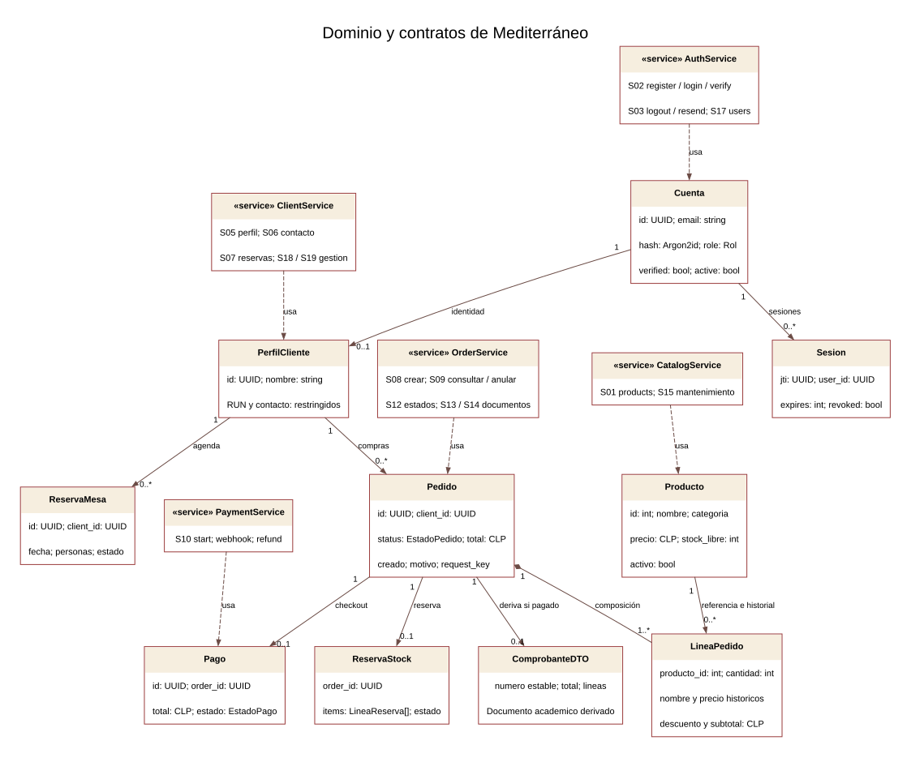
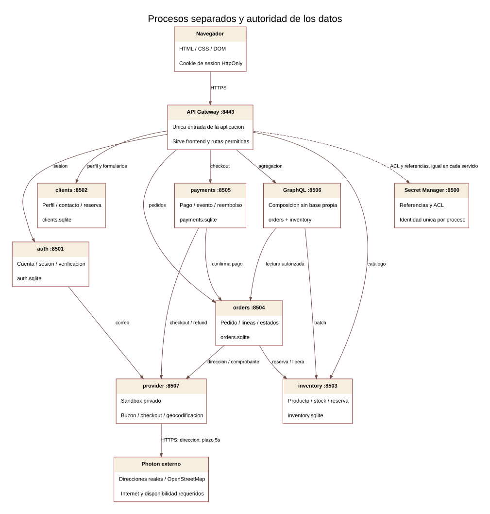
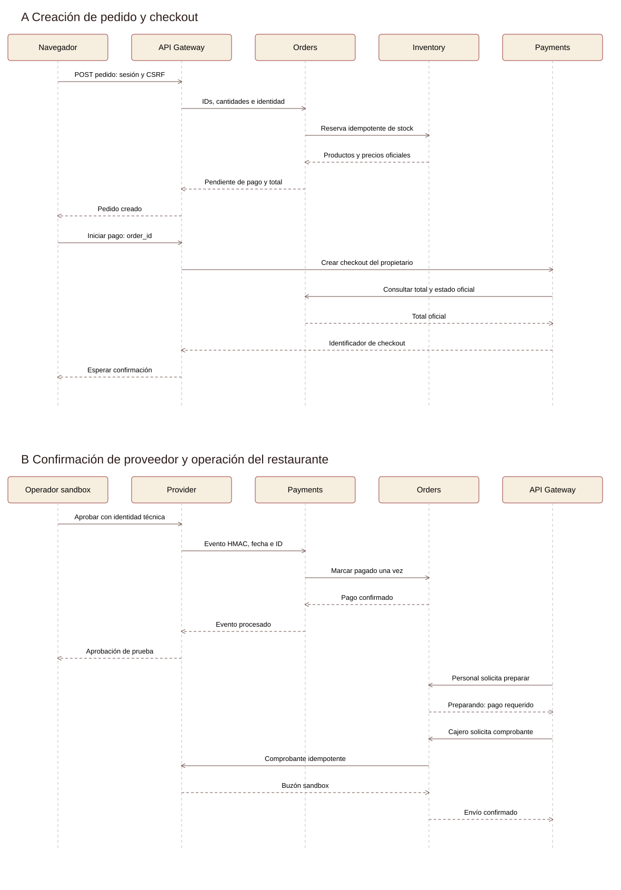
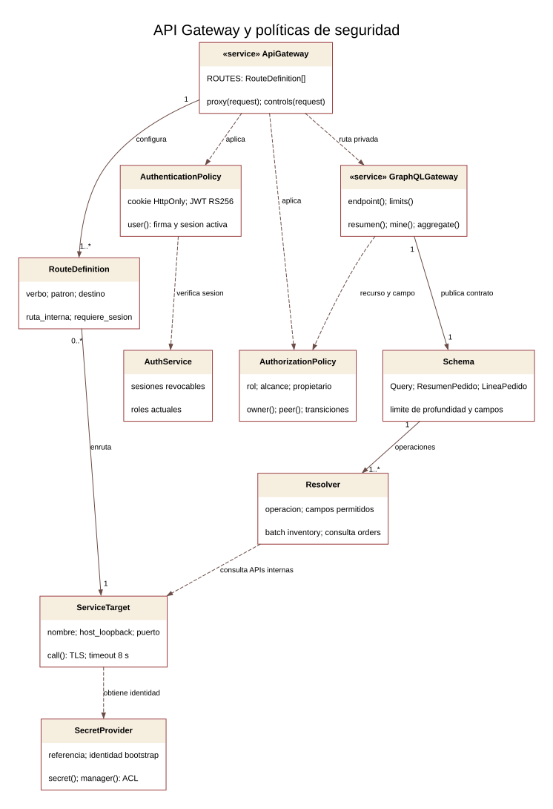

# Evaluación 2 de Mediterráneo

**Diseño e implementación de un backend seguro integrado**

Caso: Comida mediterránea Mediterráneo, descrito por la estudiante como hummus, falafel y shawarma. Equipo consignado en el frontend recibido: Maximiliano Urizar y Fabian Monardez. Versión de entrega: 1.1, 7 de noviembre de 2026. Frontend de origen: siete páginas HTML, Bootstrap, CSS y JavaScript sin compilación. Este informe describe el código de esta carpeta y las verificaciones ejecutadas; sus límites no equivalen a una certificación de producción.

La implementación transforma el catálogo, el acceso simulado y los formularios del prototipo en operaciones sobre servicios FastAPI con bases SQLite persistentes. Inventory, orders, clients y payments son procesos privados independientes, con contratos explícitos y propiedad separada de los datos. Auth, API Gateway, gestor de secretos, GraphQL y un proveedor sandbox completan el circuito. El sistema puede iniciar, crear y verificar una cuenta, reservar stock, crear un pedido, confirmar un pago firmado, emitir un comprobante académico y recorrer el despacho. El frontend mantiene su apariencia y añade las pantallas de cuenta, confirmación y gestión necesarias para esos flujos.

## Fuentes alcance y decisiones

La Evaluación 2 es la fuente de los diez módulos. La aclaración docente del 8 de noviembre de 2026 establece que se integran los componentes del backend y que la integración visual del frontend es opcional. Las pantallas y sus eventos se usan para derivar los contratos. La Evaluación 1 explica el alcance del frontend recibido. Caso19 describe específicamente Fukusuke Sushi-Delivery; se usa como referencia funcional adaptada, por ser el único caso detallado proporcionado en esta conversación. No acredita por sí solo que sus restricciones antiguas apliquen a todos los equipos.

| Tema | Decisión de esta implementación | Alcance y fundamento |
|---|---|---|
| Tecnología | Python 3.12, FastAPI y SQLite por servicio | La estudiante indica que Python/FastAPI es lo trabajado. Se declara la diferencia con Oracle y .NET/J2EE del ejemplo; requiere confirmación docente si esas restricciones siguen vigentes. |
| Carta | Se conservan los 13 platos del frontend y se agrega el menú del día como producto | No se inventan fotos de shawarma ni se sustituye la carta ya entregada. El nombre temático del caso no prueba una exigencia de cada plato específico. |
| Delivery | Gratuito dentro de 3 km, sin mínimo de compra | Adaptación de la regla de Caso19. Se corrige la promesa distinta del frontend de envío gratis sobre $20.000. |
| Ubicación | Punto ficticio -33.4372, -70.6506 | La dirección original solo decía Santiago. Orders obtiene la ubicación de provider a partir de la dirección escrita y comprueba el radio de 3 km. Provider consulta Photon para domicilios reales y dispone de un domicilio ficticio explícito para la demostración sin Internet. La geocodificación no verifica residencia. |
| Reservas | 24 plazas por jornada, grupos de 2 a 12; lunes cerrado | Decisión del equipo para completar el formulario existente. La reserva está solicitada hasta confirmación de administración; no se afirma que 24 sea la capacidad real del local. |
| Promociones | 15 % desayuno hasta 11:30; postres 2x1 los domingos por pares del mismo producto; menú del día martes a viernes 12:30–15:30 | Interpretación explícita de los anuncios existentes. Se amplía desayuno a los platos de esa categoría para evitar exigir un café que no existe en la carta. El servidor aplica los importes en CLP y conserva su cálculo en el pedido. |
| Horario | Apertura propuesta 08:30 | Se ajustó el texto heredado de apertura 12:30 para hacerlo compatible con la promoción de desayuno antes de 11:30. No se atribuye este horario al profesor. |
| Compra | Cliente registrado y correo verificado; anulación solo antes de preparación | El stock se reserva al crear pedido; el pago habilita preparación. Se conserva el historial de pedidos y productos desactivados. |
| Proveedor externo | Sandbox privado de correo y pago | No se recibieron credenciales de proveedores reales. El adaptador usa autenticación, firma, repetición segura y estados verificables; no reemplaza los servicios propios. |
| Boleta | Comprobante digital académico no tributario | No existe integración con emisión tributaria. Debe reemplazarse por un proveedor habilitado si el docente pide emisión fiscal real. |
| Diagrama de referencia | Nueve casos de uso de Fukusuke | Se adapta el vocabulario a Mediterráneo; se resuelve como despacho el rol que la tabla llama bodega y el diagrama llama encargado de despachos. |

## Módulo 1 Servicios derivados del frontend

Pantallas de origen: P01 inicio, P02 menú, P03 promociones, P04 nosotros, P05 contacto, P06 reserva y P07 delivery. Se añaden P08 cuenta, P09 confirmación de pedido y P10 gestión. Inicio y menú reutilizan S01 catálogo. Promociones comunica reglas que se verifican al crear pedido; no necesita un endpoint de escritura propio. Nosotros es contenido editorial estático sin operación de backend. El carrito es un borrador local sin datos personales; se convierte en pedido mediante una solicitud al servidor.

La matriz completa está en **servicios.csv**. Cada fila vincula requisito, pantalla, verbo, ruta, entrada, salida, errores, clasificación y acceso. Los contratos OpenAPI por sistema y `contratos/ejemplos.json` detallan tipos y ejemplos ficticios. Los tipos de entrada usan Pydantic; los endpoints que reciben estados o cambios parciales validan explícitamente campos permitidos. La API no acepta un precio, total o confirmación de pago del navegador.

En ancho móvil se mantiene el mismo contrato que en escritorio. La grilla cambia visualmente; no se duplican endpoints. Toda operación de modificación informa progreso, éxito o error en el DOM. La carga del menú permite reintentar; una lista vacía se presenta sin romper el resto de la página. Los errores de dependencias usan 503, la ausencia de sesión 401, los permisos insuficientes 403, los recursos inexistentes 404, los conflictos de stock o estado 409 y los datos inválidos 422.

## Módulo 2 Clases y cardinalidades del dominio



Fuente editable: `diagramas/dominio.dot`. Las interfaces con estereotipo service representan contratos públicos implementados como handlers de los módulos FastAPI; no se afirma que cada interfaz sea una clase Python concreta. Las líneas continuas son asociaciones, el rombo de Pedido a LíneaPedido representa composición y las líneas punteadas son dependencias de uso. Los DTO Pydantic separan entradas del modelo persistido. Los atributos de contraseña y sesiones nunca forman parte de un DTO de cliente público.

| Origen | Destino | Multiplicidades | Regla de negocio |
|---|---|---|---|
| Cuenta | PerfilCliente | Cuenta 1 → perfil 0..1; perfil → cuenta 1 | Las cuentas del personal no tienen ficha de cliente. Cada registro de cliente crea una ficha. |
| Cuenta | Sesión | Cuenta 1 → sesiones 0..*; sesión → cuenta 1 | Puede haber más de un acceso; cada JWT identifica una sesión revocable. |
| PerfilCliente | Pedido | Cliente 1 → pedidos 0..*; pedido → cliente 1 | Solo compra una cuenta registrada y verificada. El identificador se mantiene para historial. |
| Pedido | LíneaPedido | Pedido 1 → líneas 1..*; línea → pedido 1 | Se exige al menos un artículo. No se persisten borradores vacíos como pedidos confirmados. |
| Producto | LíneaPedido | Producto 1 → líneas 0..*; línea → producto 1 | La línea conserva nombre, precio y descuento históricos aunque cambie el catálogo o se desactive un producto. |
| Pedido | Pago | Pedido 1 → pago 0..1; pago → pedido 1 | Un checkout por pedido, recuperable mediante idempotencia; un reembolso es estado del pago. |
| Pedido | ReservaStock | Pedido 1 → reserva 0..1; reserva → pedido 1 | Los intentos rechazados pueden no reservar; una reserva se libera a lo sumo una vez. |
| PerfilCliente | ReservaMesa | Cliente 1 → reservas 0..*; reserva → cliente 1 | Se exige sesión para solicitar y solo propietario o administración puede gestionarla. |
| Pedido | ComprobanteDTO | Pedido 1 → comprobante 0..1 lógico | Se deriva del pedido pagado, con número estable DEMO-ID; no es una tabla fiscal independiente. |

`Order` y `Item` son contratos de creación; `Product` es contrato de mantenimiento. Registro recibe datos personales porque los exige la adaptación del caso. La agregación GraphQL no expone RUN, fecha de nacimiento ni contraseña. Las correspondencias de operaciones UML con IDs están en servicios.csv.

## Módulo 3 Sistemas e integraciones



| Sistema | Autoridad de datos | Servicios y colaboración | Identidad | Fallos |
|---|---|---|---|---|
| inventory | Producto, stock libre, reserva de unidades | S01, S15; recibe reserve/release de orders, batch de GraphQL | gateway, orders, graphql; funciones internas limitadas por llamador | Reserva atómica con BEGIN IMMEDIATE; 409 sin stock. Liberación idempotente. |
| orders | Pedido, líneas históricas, estados, motivo y envío de comprobante | S08–S14, S16, S20; consulta inventory, payments y proveedor | gateway, graphql; confirmación de pago solo desde payments | Estado cancelando durable; reconciliación reintenta compensación. |
| clients | Fichas, contactos y reservas de mesa | S05–S07, S18–S19; alta interna desde auth | gateway; perfil propio también GraphQL | Compensa alta de cuenta si no pudo crear ficha; cupo serializado. |
| payments | Checkout local, total confirmado, eventos y reembolso | S10; importe desde orders, checkout y devolución al proveedor | gateway, orders, provider | Firma HMAC y ventana de cinco minutos; evento repetido no duplica efectos. |
| auth | Correo de cuenta, hash, rol, verificación, sesiones | S02–S04, S17; alta de ficha y envío de código | gateway; validación de sesión desde servicios autorizados | Sin sesión válida se rechaza. Cuenta recién creada puede reenviar correo si falló el proveedor. |
| GraphQL | Sin datos de negocio propios | S11 combina orders e inventory | Solo gateway | Devuelve datos históricos con aviso si inventory falla; no consulta otras bases. |
| Gestor de secretos | Valores y ACL simbólicas | Resolución de JWT y firma de pagos; identificación entre servicios | Bootstrap individual por servicio | Falla cerrada 503. No hay clave de respaldo en el código. |
| provider | Buzón sandbox, checkouts y deduplicación de comprobantes | Adaptador separado; operador técnico aprueba pago de prueba | auth, payments, orders y operador según operación | Reintento del mismo checkout/recibo no duplica el recurso. |

### Secuencia de compra



Orders crea un identificador estable y un estado reservando, solicita reserva de stock y guarda el total. El frontend recibe pendiente_pago. Payments consulta ese pedido y toma su total oficial. El operador independiente aprueba el checkout en el proveedor sandbox. El proveedor emite un evento firmado; payments lo valida y llama a orders para marcar pagado. Recién entonces caja o despacho puede pasar a preparando. El comprobante se deriva de las líneas históricas y el cajero solicita enviarlo al correo del cliente a través del adaptador.

La coordinación es una saga sencilla, no una transacción distribuida: si falla un tramo, se registra cancelando y se reintenta desde Reconciliar. Se puede repetir reserva, liberación, checkout, evento y comprobante sin duplicar su efecto principal. La reconciliación de reservas vencidas es manual en esta entrega y debe programarse en una instalación operativa.

## Módulo 4 Stakeholders y permisos HTTP

| Stakeholder | Rol o identidad | Interés |
|---|---|---|
| Visitante | Anónimo | Consultar carta, promociones, información y enviar contacto. |
| Comprador | client | Perfil propio, reservas, pedidos y comprobantes propios; inicia pago pero no lo confirma. |
| Administración | admin | Productos, usuarios, clientes, reservas, contactos y operación del restaurante. |
| Propietario | owner | Catálogo administrativo y reporte agregado de ventas; los listados no le revelan direcciones. |
| Caja | cashier | Pedidos, comprobantes y transición operativa autorizada. |
| Despacho y cocina | dispatch | Orden imprimible y estados posteriores al pago. |
| Proveedor | provider | Aviso firmado de pago y servicios sandbox; no representa una cuenta de comprador. |
| Operador de pruebas | operator | Consola privada del sandbox, mediante archivo local de identidad independiente. |
| Docente evaluador | Sin permisos operativos permanentes | Reproduce la entrega con cuentas ficticias generadas en su instancia. |

**permisos.csv** expresa decisión por rol, servicio, ruta, verbo, alcance y punto de comprobación. Cada sistema conserva su validación de propiedad y estado aunque ya se haya pasado por el gateway. Ocultar controles visuales no otorga ni sustituye permisos. Borrar producto equivale a desactivarlo para preservar historial; anular un pedido conserva su motivo. El administrador puede desactivar cuentas y revocar sus sesiones.

## Módulo 5 API Gateway y políticas



Se implementa un gateway externo; separar varios no aporta una necesidad en esta escala. Su lista ROUTES define destinos cerrados, expresiones de ruta y verbos. El navegador no decide una URL interna. El proxy descarta Authorization y cabeceras de identidad aportadas por el cliente, toma la sesión de la cookie y añade únicamente su identidad de servicio y el token verificable. Cada servicio consulta el estado vivo de la sesión en auth y sus reglas de recurso.

RouteDefinition y las políticas del UML representan las tuplas ROUTES y el middleware de la implementación. ApiGateway y GraphQLGateway son interfaces arquitectónicas; las operaciones concretas son funciones FastAPI. SecretProvider se implementa mediante `secret`, `manager` y la ACL del gestor. La relación de rutas es estructural; las líneas punteadas representan dependencias y no relaciones entre registros.

Una solicitud permitida GET de pedido lleva cookie válida al gateway, identidad gateway y JWT al servicio, verificación de sesión en auth y comprobación de dueño del recurso en orders. La misma solicitud con otra cuenta se rechaza 403; no retorna dirección, líneas ni total del pedido ajeno. Un acceso directo al puerto privado sin identidad recibe 403.

Todos los listeners se enlazan a loopback. Esta separación impide acceso desde otras máquinas; además se exige identidad técnica para las operaciones internas. El usuario del sistema operativo que ejecuta la aplicación puede leer sus archivos; no se pretende aislar de un administrador local. Para producción deben usarse cuentas de proceso y aislamiento de secretos equivalentes a contenedores o una plataforma administrada. No se requiere una nube pagada para reproducir estas fronteras.

## Módulo 6 Rutas y secretos de integración

Las rutas externas se documentan en servicios.csv y en la tabla ROUTES del gateway. `/api/auth/login` se transforma en auth `/login`; el resto conserva su ruta salvo el prefijo externo `/api`. Las rutas `/internal/*`, `/operator/*` y `/v1/secrets/*` no se publican en el gateway. GraphQL usa POST `/api/graphql`, pero sus campos y recursos tienen controles adicionales.

| Referencia | Tipo y emisor | Consumidor | Alcance y ubicación |
|---|---|---|---|
| service.gateway y service.* | Token aleatorio generado en configurar.py | Un proceso por archivo bootstrap | Identifica llamador al gestor. Cada endpoint restringe qué identidades pueden invocarlo. No se inserta en URL, JS, capturas o logs. |
| jwt_private | RSA privada de auth | Solo auth | Firma JWT. ACL del gestor impide leerla desde inventory u otros servicios. |
| jwt_public | RSA pública | Gateway y servicios de negocio | Verificación de firma, issuer, audience y claims obligatorios; no es un secreto confidencial. |
| payment_hmac | Clave aleatoria del contrato de proveedor | payments y provider | Firma de timestamp más cuerpo exacto del evento, ventana cinco minutos. |
| operator.bootstrap | Token técnico distinto | Consola de operador | Única identidad que puede leer buzones de prueba y aprobar checkouts sandbox. Nunca se entrega al navegador del comprador. |
| session | JWT de usuario | Cookie del gateway | HttpOnly, Secure, SameSite Strict, 30 minutos; revocación al salir o al cambiar rol/estado. |
| csrf | Valor aleatorio por login | Cookie legible y cabecera X-CSRF-Token | Comprueba correspondencia y origen en modificaciones con sesión. No autentica por sí solo. |
| clave de usuario | Contraseña elegida | Auth recibe, conserva solo hash | Argon2id con sal aleatoria; ni hash ni clave salen a las APIs públicas. |

El gestor es una implementación local reducida con ACL; no se presenta como HashiCorp Vault. Su archivo completo solo se usa en el proceso gestor por convención de despliegue local; contiene valores sin cifrar, protegidos por permisos del directorio. La rotación local se implementa con servicios detenidos mediante rotar.py, conserva datos e invalida JWT previos. La revocación individual de usuario es inmediata en auth. No hay rotación automática ni auditoría externa inmutable.

Las comunicaciones de navegador y servicios usan TLS con un certificado de demostración generado localmente y verificado por los clientes internos. No se guarda en el ZIP ninguna clave privada. El gestor inaccesible produce rechazo; los secretos no se incrustan como fallback.

## Módulo 7 Datos sensibles y secretos del cliente

| Dato | Finalidad y clase | Custodio | Acceso y representación | Retención propuesta |
|---|---|---|---|---|
| Nombre y descripción del plato | Catálogo público | inventory | Todos; sin campos de clientes | Vida del producto; desactivación lógica para historial. |
| RUN, fecha de nacimiento y sexo | Campos exigidos por el caso de referencia; datos personales restringidos | clients | Titular y administración; nunca catálogo ni GraphQL de pedidos | Mientras exista relación de cliente; revisar necesidad antes de producción. |
| Correo y teléfono | Contacto y verificación, restringidos | auth/clients según autoridad | Titular y administración. Correo verificado no editable sin un nuevo proceso de verificación | Vida de cuenta; borrado sujeto a conservación justificada de ventas. |
| Dirección | Entrega, personal | clients y copia histórica en orders | Titular, administración, caja y despacho; owner no recibe dirección | Hasta resolver despacho y reclamos; luego anonimizar según política aprobada. |
| Historial de pedido | Compra, soporte y reporte | orders | Propietario y personal autorizado; reporte del dueño agregado | Conservación justificada de ventas; nunca borrar mediante una anulación. |
| Contraseña y sesión | Credenciales | auth | Solo hash en disco y JWT en cookie segura; no en localStorage | Sesión 30 minutos; verificación 30 minutos y un uso; hash mientras cuenta activa. |
| Datos del formulario contacto | Respuesta al cliente, restringidos | clients | Solo administración; no se publican listados anónimos | Política propuesta de 90 días tras resolución. |

La aplicación no custodia tarjetas, claves bancarias ni secretos de un proveedor pertenecientes al cliente. La clave de payments es del comercio/integración, no un dato personal del comprador. No se almacena un número de tarjeta en ninguna pantalla.

Recorrido de dirección: el titular la captura; el gateway transporta por HTTPS; orders valida longitud y resuelve la dirección mediante el adaptador privado antes de comprobar el radio, la copia al pedido y solo la devuelve a los roles autorizados. El frontend usa textContent para mostrarla. No se registra en logs. Se conserva para operación y reclamos; la anonimización al vencer el plazo es una política documentada pendiente de automatización, no una función que esta entrega afirme ejecutar.

Los archivos SQLite se almacenan bajo el directorio privado `.runtime` y no se publican. Esta versión no cifra las bases con claves separadas; la protección en reposo depende del acceso del sistema operativo y debe complementarse con disco cifrado y respaldos protegidos en un despliegue real. Los logs contienen servicio, correlación, método y estado, sin cuerpos, tokens ni datos personales. La política de retención y su ejecución deben ajustarse al contexto real antes de usar información de personas.

Las pruebas verifican catálogo anónimo, sesión ausente, rol insuficiente, pedido ajeno REST/GraphQL, identidad interna ausente, firma alterada de pago y CSRF. Las evidencias se encuentran en el XML de pruebas y en resultados-resiliencia.json; no se reemplazan por afirmaciones del diseño.

## Módulo 8 GraphQL y separación por naturaleza

Inventory, orders, clients y payments son servicios transaccionales. Auth y el gestor son infraestructura de seguridad. GraphQL es composición sin datos propios. Provider representa integración externa de prueba. El reporte es una consulta agregada pequeña en orders; no se crea un servicio analítico solo por existir SUM y COUNT.

El schema real está en backend/schema.graphql. La pantalla Mi cuenta ejecuta `misPedidos` y obtiene estado/total de orders y descripciones actuales de inventory. El resolver reúne IDs y hace una consulta batch; no una llamada por línea. `resumenPedido` reutiliza esa composición para un recurso. Las reglas de stock y pago permanecen en sus microservicios.

```graphql
query Resumen($id: ID!) {
  resumenPedido(id: $id) {
    id
    estado
    total
    lineas { nombre cantidad descripcionActual }
    aviso
  }
}
```

Respuesta ficticia de referencia:

```json
{"data":{"resumenPedido":{"id":"pedido-ficticio","estado":"pagado","total":9800,"lineas":[{"nombre":"Moussaka","cantidad":1,"descripcionActual":"Berenjena, carne, papas y bechamel gratinada al horno."}],"aviso":null}}}
```

| Operación o campo | Control |
|---|---|
| misPedidos | Sesión verificada; orders filtra cliente o aplica alcance del personal; limit 1..30 y offset no negativo. |
| resumenPedido | Comprobación de propietario o rol en orders antes de devolver datos. |
| direccion | Solo client propietario, admin, cashier o dispatch; owner recibe error de campo si la pide. |
| Contraseñas y RUN | Ausentes del schema; consulta inválida rechazada antes de resolver. |
| Consumo | Una operación; máximo 6000 caracteres, profundidad 4, 50 campos, dos selecciones raíz; no fragments ni introspección. |
| Tiempo y fallos | Plazo total 10 s y llamadas de servicio 8 s; inventory caído conserva las líneas históricas con descripción actual nula y aviso. |

Este contrato deliberadamente reducido no es una API GraphQL general con federación. Las pruebas de costo y paginación limitan el volumen a como máximo dos listados de 30 pedidos por operación; no existe acceso directo a las bases de los subsistemas. Las mutations permanecen en REST porque son operaciones de negocio existentes y no una necesidad de la pantalla de agregación.

## Módulo 9 Analítica gRPC y carga

### ADR 01 Comunicación y analítica

**Contexto.** Restaurante académico, mensajes pequeños y solicitudes humanas de catálogo, pedido y despacho. No se recibió una medición de tráfico real ni un requisito de telemetría, streaming o millones de registros. La carga objetivo inicial es una hipótesis de cinco clientes concurrentes, no una previsión demostrada del negocio.

**Alternativas.** REST JSON privado, gRPC interno con mensajes tipados, servicio analítico separado con actualización diferida o reporte SQL acotado dentro de orders.

**Elección.** REST para la colaboración transaccional, GraphQL para la agregación requerida y reporte agregado en orders. No se añade gRPC ni un microservicio de big data. La comunicación actual no requiere streaming ni un contrato que justifique mantener cliente, servidor y certificados gRPC adicionales.

**Consecuencias.** Menos componentes para reproducir y explicar; no se alegan mejoras comparativas frente a gRPC. Si aparecen seguimiento continuo de flotas, alta frecuencia de eventos o reportes que afecten transacciones, esta decisión debe revisarse con datos. GraphQL no ejecuta por sí solo analítica intensiva.

**Evidencia.** scripts/carga.py realiza 100 solicitudes, cinco trabajadores y combinación de catálogo/reporte, con datos ficticios de la suite. Registra duración, p95, throughput, errores, CPU y RSS en resultados-carga.json. Objetivo declarado: p95 menor a 1000 ms y cero errores. El resultado prueba esa muestra; no prueba capacidad de producción ni un volumen masivo. CPU es suma de porcentajes por proceso, puede superar 100 % en un equipo con varios núcleos; RSS es instantánea, no máximo. El reporte no contiene datos personales.

## Módulo 10 Integración completa y validación

Se entregan frontend, backend, contratos, esquema y creación de tablas, datos ficticios iniciales, dependencias versionadas y scripts de configuración, arranque, pruebas y rotación. Las bases se crean con DDL idempotente en cada módulo, y la siembra no reemplaza cuentas existentes. El sistema es ejecutable localmente sin cuenta cloud y sin Docker.

| Flujo | Estado de implementación | Evidencia |
|---|---|---|
| Registro y verificación | Auth, perfil persistente, correo sandbox y código de un uso | test_registro_validacion_correo_y_sesion |
| Catálogo, filtros y carrito | Menú consulta API real y usa DOM; borrador local con ID de producto | test_catalogo_anonimo_y_datos_publicos; resultados-navegador.json |
| Pedido y disponibilidad | Total calculado, reserva atómica e idempotencia | test_pedido_idempotente_precios_y_stock; test_stock_concurrente_sin_sobreventa |
| Pago y repetición | Checkout real del servicio propio, adaptador sandbox firmado y eventos deduplicados | test_pago_firmado_duplicados_despacho_y_comprobante |
| Pago alterado | Se ignora cualquier total del navegador; firma inválida rechazada | test_pago_alterado_y_firma_invalida |
| Anulación y reembolso | Motivo obligatorio, estado permitido, devolución sandbox y stock una vez | test_anulacion_reembolso_y_recuperacion_stock |
| Despacho y comprobante | Estados secuenciales, orden imprimible y correo sandbox idempotente | test_pago_firmado_duplicados_despacho_y_comprobante |
| Reservas y contacto | Persistencia, cupo, fechas y permisos | test_contacto_reservas_y_perfil |
| Administración | Productos, clientes, roles, desactivación y reporte | test_admin_catalogo_roles_reporte |
| Propiedad y secretos | REST/GraphQL, identidad interna, ACL, CSRF y revocación | test_roles_propiedad_y_cabeceras_falsas; test_red_privada_y_acl_secretos; test_csrf_y_sesion_revocada |
| Fallos | Inventory no disponible, gestor caído y cancelación interrumpida | resultados-resiliencia.json |
| Reinicio | Pedido entregado y sesión siguen consultables después de detener y reiniciar los nueve procesos | resultados-persistencia.json |

La matriz detallada requisito–pantalla–servicio–prueba–resultado–evidencia está en trazabilidad.csv. Las salidas de pytest corresponden a pruebas HTTP de servicios reales; la carga no usa respuestas fijas. Se excluyen de la entrega claves, bases de la ejecución y tokens de prueba.

### Resultados de la verificación final

| Comprobación | Resultado observado |
|---|---|
| Pruebas automatizadas HTTP y reglas de negocio | 17 aprobadas, 0 fallidas |
| Fallos de dependencias | 3 escenarios aprobados |
| Navegador | Compra completa y 32 comprobaciones sin desborde en 375, 768, 1024 y 1440 px |
| JavaScript | Sin errores de ejecución durante el recorrido automatizado |
| Persistencia | Pedido y sesión conservados después de reiniciar los nueve procesos |
| Carga de lectura | 100 solicitudes, 5 concurrentes, 0 errores; ver resultados-carga.json de esta versión |

La comprobación visual se realizó con Chromium headless en Linux. El recorrido manual de la versión 1.0 se ejecutó después en Windows con Python 3.14, según las evidencias aportadas en esta conversación. La versión 1.1 también se demostró manualmente en Windows con Python 3.14: pedido de $6.500, pago sandbox, comprobante, entrega, reserva, contacto y conservación después del reinicio. Las capturas se incluyen en el informe Word final. El ajuste de Contacto y Reserva para móvil reduce el gutter horizontal excesivo del frontend recibido. Las capturas se usaron para revisión interna; la entrega conserva resultados de pruebas y scripts reproducibles. Las advertencias de httpx sobre su parámetro de certificado en algunos scripts de prueba son de deprecación y no alteraron la verificación TLS de las solicitudes.

### Límites que deben revisarse antes de presentar

La adaptación del caso y la elección FastAPI/SQLite están declaradas para revisión docente. La verificación por correo se demuestra mediante un buzón sandbox aislado; no acredita entregabilidad de correo en Internet. El pago no mueve dinero; la boleta es un comprobante académico. La consulta a Photon requiere Internet y disponibilidad del proveedor público de demostración. No se verificó su conectividad desde este entorno ni desde el equipo del estudiante. No hay emisión fiscal, automatización de retención ni scheduler de reconciliación. Los servicios de desarrollo corren bajo un mismo usuario local y comparten un certificado de demostración. Se debe configurar aislamiento adicional, certificados propios y proveedor real si el alcance pasa a producción.

Las funciones de reserva y contacto heredadas se incorporaron por formar parte del frontend; la capacidad, radio, horarios y promociones son decisiones explícitas. La pantalla de reservas no impone turnos horarios porque el formulario original solo incluye fecha. Los datos del local y las fotografías se conservaron como material académico; no se inventan licencias o procedencias de imágenes. La documentación no debe confundirse con confirmación de requisitos verbales que no fueron aportados.

### Referencias técnicas consultadas

- FastAPI, seguridad con JWT y hash: https://fastapi.tiangolo.com/tutorial/security/oauth2-jwt/
- GraphQL, límites y seguridad: https://graphql.org/learn/security/
- Pautas de Evaluación 1 y Evaluación 2 y documento Caso19 proporcionados por la estudiante.

Bootstrap y Bootstrap Icons se distribuyen como dependencias visuales locales con sus encabezados de licencia originales. No se incluyen servicios o secretos de otros proyectos.

## Ajustes finales y evidencias de la versión 1.1

La respuesta docente compartida confirma ejecución en localhost. Los servicios continúan en loopback y el navegador accede por HTTPS al gateway 8443. La versión 1.1 comprueba puertos antes de arrancar, espera el health check de cada proceso y corrige el cierre del árbol de procesos de Python en Windows. Se incorpora detener.py para recuperar una instancia anterior sin borrar datos.

El recorrido manual aportado por el estudiante en Windows con Python 3.14 verificó catálogo y carrito, registro con RUN válido, correo sandbox, login, creación de un pedido de $10.700, validación de pago sandbox, comprobante, administración, estados preparando/despachado/entregado, envío de comprobante al buzón y persistencia tras reiniciar. Estas observaciones pertenecen a la versión anterior al ajuste del formulario de dirección. Las capturas de la versión 1.1 ya fueron aportadas e incorporadas al informe Word final.

El nuevo formulario solo solicita dirección. Orders conserva compatibilidad de entrada con lat/lon opcionales, pero siempre ignora esas coordenadas al autorizar cobertura. El adaptador privado de provider acepta POST /internal/geocode únicamente desde la identidad orders, recibe {direccion}, devuelve {lat, lon, source} y rechaza llamadas sin identidad. No se publica esa ruta en el gateway. La geocodificación consulta Photon mediante HTTPS con timeout de 5 s. Un lock limita concurrencia a una consulta, con intervalo mínimo de un segundo y caché SQLite privada de 24 horas, purgada al realizar nuevas consultas. El endpoint se configura mediante GEOCODER_URL. No requiere credencial de pago en este proveedor público de demostración.

Solo se transmite el texto de dirección, nunca RUN, nombre, correo, JWT o identificador del pedido. El formulario informa la consulta externa y atribuye los datos a OpenStreetMap. Las coincidencias deben ser de Chile, contener calle y número correspondientes a la entrada, y ser únicas. Una ausencia o ambigüedad produce 422 y una indisponibilidad produce 503, conservando el carrito. El costo y el timeout del servicio interno siguen limitados por el contrato común de 8 s. Una ubicación fuera del radio produce 422 antes de insertar un pedido o reservar stock.

La dirección ficticia Dirección de prueba 123, Santiago se resuelve localmente como parte explícita del adaptador académico. Esto permite reproducir el flujo sin depender de Internet. No se afirma que ese domicilio exista ni que la cobertura demuestre correspondencia de un domicilio real. Para usar otros domicilios se necesita conectividad con Photon y cobertura suficiente de sus datos. El test de direcciones usa un proveedor HTTP local controlado y verifica éxito sin coordenadas, ausencia de resultado, indisponibilidad, rechazo fuera de cobertura aun con coordenadas manipuladas y repetición de una clave de idempotencia.

La elección de no incorporar gRPC y analítica separada sigue documentada en ADR 01. Esta muestra de carga es de lecturas internas, no mide la capacidad del proveedor público de direcciones. La política del servidor Photon permite proyectos con solicitudes razonables y no garantiza disponibilidad, según https://github.com/komoot/photon.

## Revisión final del 8 de noviembre de 2026

Se extrajo el ZIP en una carpeta nueva, se instalaron sus dependencias y se repitieron las 17 pruebas HTTP, los tres escenarios de resiliencia, la carga de 100 solicitudes y la comprobación de persistencia. Los resultados de esta repetición están en resultados-revision-final.json. Las mediciones previas se conservan para que las cifras citadas en el informe sigan siendo trazables. El Word entregado por separado contiene los diagramas visibles y las capturas manuales finales.
